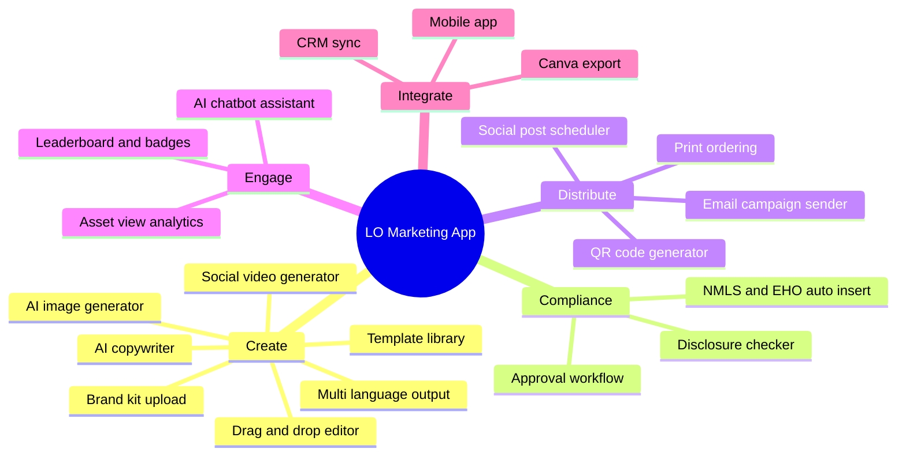
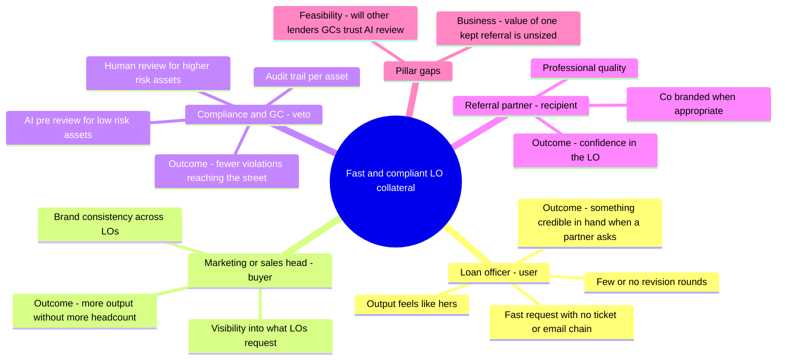
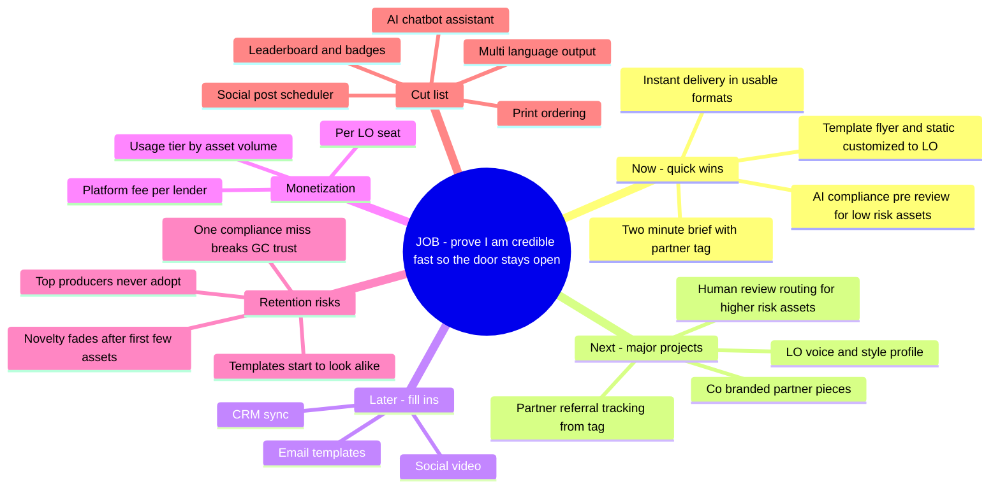

# Strategic Discovery Map (Module 1)

**Scenario:** Option C · A B2B product sold to mortgage lenders that gets retail loan officers on-brand, compliant marketing collateral fast.
**Lab structure:** three prompts, each adding PM context, then a V1 vs. V3 comparison. The AI drafts the maps. The PM makes the judgments.

> Effort, impact, and monetization labels in V3 are **hypotheses** to test in M3–M5. They are not findings.

---

## V1 · Baseline

**Prompt 1:**
> Create a mindmap of features for an AI app that helps mortgage loan officers create marketing materials.

**What V1 is:** about 20 features, all equal weight. No user, no buyer, no job, no order. It's a feature factory.

---

## V2 · With Modern PM context

**Prompt 2:**
> Rebuild the map as a PM would. Organize by stakeholder (user, buyer, veto holder, end recipient), name the outcome each one needs, and test each branch against the three pillars: customer need, business goal, and feasibility. This is B2B: the user is the loan officer, the buyer is the lender's head of marketing or sales, and compliance holds a veto.

**What changed from V1:** features now hang off stakeholders and outcomes. Distribution, gamification, and the chatbot have no branch that needs them.

---

## V3 · JTBD, effort vs. impact, monetization, retention risk

**Prompt 3:**
> Put the job to be done at the center: "When a partner or prospect gives me an opening, help me prove fast that I'm a credible, reliable professional so the door stays open." Score every remaining feature on impact against that job and effort to build. Add how the lender pays and what could make LOs or lenders stop using it. Start with new LOs (licensed under one year) and the most-requested asset: statics and flyers. List what gets cut.

### V3 scoring table

| Feature | Job it serves | Impact (hyp.) | Effort (hyp.) | Quadrant | Retention risk it addresses |
|---|---|---|---|---|---|
| Two-minute brief with partner tag | Removes ticketing and email chains; enables before/after referral measurement | High | Low | Now | Process friction drives LOs back to DIY |
| Template flyer and static customized to LO | Most-requested asset; credible in hand fast | High | Low–Med | Now | Novelty fade |
| AI compliance pre-review (low-risk only) | Speed without violations | High | Med | Now | One miss breaks GC trust → keep scope low-risk |
| Instant delivery in usable formats | Ready when the partner asks | Med | Low | Now | — |
| LO voice and style profile | "Feels like mine" | Med–High | Med | Next | Templates look alike |
| Co-branded partner pieces | Come through for a partner | High | High (RESPA / co-marketing review) | Next | — |
| Human review routing for higher-risk assets | Keeps compliance in control | Med | Med | Next | GC trust |
| Partner referral tracking | Proves the outcome | Med (for buyer) | Med | Next | Buyer renewal |
| Email, social video, CRM sync | Adjacent formats | Low–Med | Med–High | Later | — |
| Leaderboard, scheduler, print, chatbot, multi-language | No link to the job | Low | Med–High | **Cut** | — |

**Success metrics carried forward to M3:** outcome = referred applications and loans from tagged partners, before vs. after delivery, for the new-LO cohort vs. a staggered-rollout control. Leading indicators = adoption and repeat use.

---

## Responses

*These are your answers to write. Notes in italics point to where the evidence is.*

- **Write one feature from the map that, if an engineer asked "why is this a priority for our 12-week roadmap?", you honestly could not give a strategic answer for.:** _(your answer)_
  *Look at V1 features that survived into V2 or V3 without a clear job link, or anything in "Later." Pick one and say why you can't defend it.*

- **Write one feature that looks "correct" for the app but has zero strategic weight, where you have no idea whether it helps the company make money or whether a single user actually asked for it.:** _(your answer)_
  *Look at V1 features that sound standard for a marketing app. The Cut list is a starting point. Which one would a stakeholder most likely push for anyway?*

- **Compare V3 to your Step 1 baseline. What changed, and is the output objectively better? Did the AI get smarter, or did your added PM knowledge (JTBD, effort/impact, retention) force it to be useful?:** _(your answer)_
  *Same model all three times. Compare what each prompt contained: V3 included the job, the new-LO segment, the compliance precedent, and partner tagging, all of which came from your Round 2–3 answers. Also note one place where V3 may still be wrong.*

- **Key takeaway: how does this prove the PM's role is to think while the AI's role is to execute?:** _(your answer)_
  *Which decisions in V3 could the AI not have made without you? Which did it make that you'd override?*
